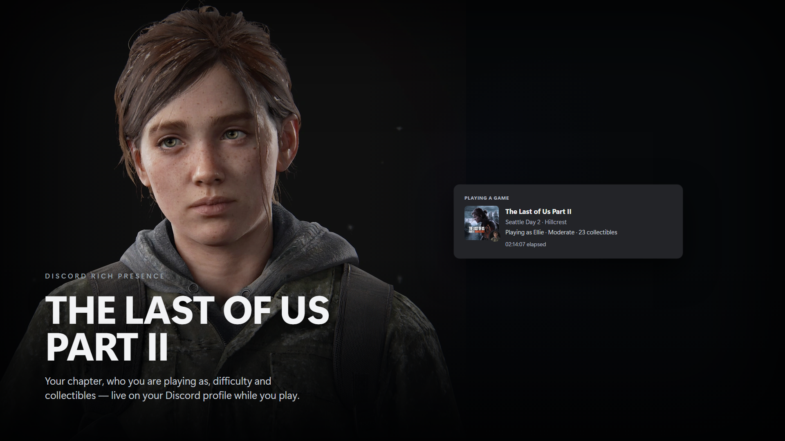
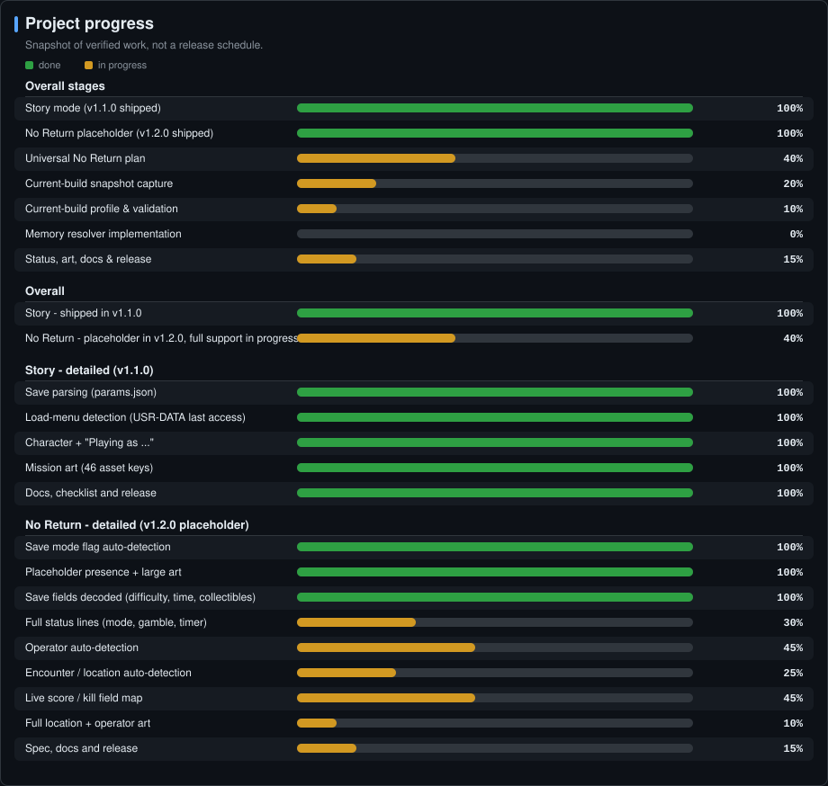

<h1 align="center">The Last Of Us Part II Discord RPC Mod</h1>



Shows what you're playing in The Last of Us Part II Remastered as a Discord status:


**[Download on Nexus Mods](https://www.nexusmods.com/thelastofuspart2/mods/965?tab=description)**

It reads the game's own autosave metadata (`params.json`), so there is **no
game modification**, no memory reading, and nothing to update when the game
patches. It runs hidden, polls every few seconds, clears your status the moment
the game closes, and exits on its own after a few minutes.

It can run two ways: as a standalone helper started by `start_tlou2_rpc.vbs`
(this folder), or as an ASI plugin that the game loads at launch - see
[Nexus package](#nexus-package-asi-plugin).

---

## Contents

- [Project status](#project-status)
  - [Overall stages](#overall-stages)
- [Quick start](#quick-start)
- [One-time Discord setup (images)](#one-time-discord-setup-images)
- [Nexus package (ASI plugin)](#nexus-package-asi-plugin)
- [Configuration (`config.json`, build time only)](#configuration-configjson-build-time-only)
- [No Return (in development)](#no-return-in-development)
  - [Planned status layout](#planned-status-layout)
  - [Kills and progress by mode](#kills-and-progress-by-mode)
  - [Art](#art)
  - [Detection plan](#detection-plan)
  - [Memory address findings (research only)](#memory-address-findings-research-only)
  - [What's added / confirmed](#whats-added--confirmed)
  - [What's missing](#whats-missing)
  - [What's needed next](#whats-needed-next)
- [Troubleshooting](#troubleshooting)
- [Files](#files)
- [How it works](#how-it-works)

---

## Project status



It is a snapshot of what is built and verified - not a release schedule. The
downloadable build is **v1.1.0** and contains story support only.

### Overall stages

| Stage | Status | Progress | Tracking |
|---|---|---:|---|
| Story mode (v1.1.0) | Shipped | 100% | Released build |
| Universal No Return plan | Drafted | 40% | [#2](https://github.com/3bdelrahmanashraf/tlou2-discord-rich-presence/issues/2) |
| Current-build snapshot capture | In progress | 20% | [#3](https://github.com/3bdelrahmanashraf/tlou2-discord-rich-presence/issues/3) |
| Current-build profile & validation | Not started | 10% | [#4](https://github.com/3bdelrahmanashraf/tlou2-discord-rich-presence/issues/4) |
| Memory resolver implementation | Not started | 0% | [#5](https://github.com/3bdelrahmanashraf/tlou2-discord-rich-presence/issues/5) |
| Status, art, docs & release | Not started | 5% | [#6](https://github.com/3bdelrahmanashraf/tlou2-discord-rich-presence/issues/6) |

| Mode | Status | Done |
|------|--------|------|
| Story | Shipped in v1.1.0 | 100% |
| No Return | Address research / design in progress, not shipped | ~35% |

### Story - detailed progress (v1.1.0)

| Area | Done | Notes |
|------|------|-------|
| `params.json` save parsing | 100% | Chapter, subchapter, difficulty, modifiers, collectibles, playtime. |
| Load-menu detection (`USR-DATA` last access) | 100% | Status updates within ~3 s of loading a slot. |
| Character and "Playing as ..." | 100% | Ellie / Abby / Joel, with chapter overrides. |
| Mission-specific large art | 100% | 46 keys; unknown keys fall back to `tlou2`. |
| Docs, checklist and release | 100% | README, changelog, `DISCORD-ASSETS.txt`, Nexus page. |

### No Return - detailed progress (not shipped)

| Area | Done | Notes |
|------|------|-------|
| Save fields (difficulty, playtime, collectibles, mode flag) | 100% | Decoded from `params.json`; not yet shown in a status. |
| Mode label / gamble difficulty / timer in the status line | 30% | Layout agreed; wiring waits on the spec. |
| Operator auto-detection | 45% | Active skin slot (`registry + 0x40`) decoded; skin-prefix map and live validation pending. |
| Encounter / location auto-detection | 25% | Level emitter and script-native names decoded; no live location slot confirmed yet. |
| Live score / kill field map | 45% | Static field offsets and the score global are decoded; state snapshots pending. |
| Large (location) + small (operator) art | 10% | Keys and fallbacks planned; no assets uploaded. |
| Spec, docs and release | 10% | Held until the design is approved. |

See [No Return (in development)](#no-return-in-development) for the full
added / missing / needed breakdown.

---

## Quick start

1. Make sure Discord is running.
2. Start the game and the mod sees the save automatically.

Nothing visible happens - that is normal. A log is written to `rpc.log`.

To see what it detects without Discord: `py -3 tlou2_rpc.py --once`.
To watch it live: `py -3 tlou2_rpc.py --console`.

**Auto-start with Windows:** right-click `start_tlou2_rpc.vbs` → *Send to* →
*Desktop (create shortcut)*, then move that shortcut into
`%APPDATA%\Microsoft\Windows\Start Menu\Programs\Startup`.
The app sits idle until `tlou-ii.exe` appears, and it cannot run twice (a named
mutex blocks duplicates).

---

## One-time Discord setup (images)

The text works immediately. Images need assets uploaded to your Discord app:

1. Open <https://discord.com/developers/applications/"yourapp">.
2. **General Information** → set the app name to `The Last of Us Part II`
   (this is the bold first line of the status).
3. **Rich Presence → Art Assets** → upload PNGs with these **exact** keys:

   | Key     | Image                       | Used for                       |
   |---------|-----------------------------|--------------------------------|
   | `tlou2` | game art / box art          | large image                    |
   | `ellie` | Ellie portrait              | small image in Ellie chapters  |
   | `abby`  | Abby portrait               | small image in Abby chapters   |
   | `joel`  | Joel portrait               | small image in the prologue    |

   512×512 PNG is the safe size; square crops look best. Ready-made 512×512
   files are already in the `assets\` folder next to this README.
4. **Mission art (optional):** the large image changes with the mission.
   `DISCORD-ASSETS.txt` lists all 46 mission keys (`hillcrest`,
   `the_birthday_gift`, `the_confrontation`, `2425_constance`, ...) grouped by
   chapter. Upload a PNG under each key you want to use. The hover text is the
   mission name automatically.
5. Wait ~5-10 minutes for Discord to publish the assets.

Until a mission key exists, the helper retries with `tlou2`, so the box art and
character icons keep working while you add art. If even those are missing it
falls back to text only; the status text never breaks.

---

## Nexus package (ASI plugin)

`dist\TLOU2-Discord-Rich-Presence-<version>.zip` is the shippable mod:

```
avrt.dll                 44 KB proxy: forwards Windows AVRT, loads the .asi
TLOU2DiscordRPC.asi
TLOU2DiscordRPC\
  tlou2_rpc.py     (settings baked in - no config.json ships)
README.txt
```

Install is "extract into the game folder". No ASI loader is needed: the game
imports `AVRT.dll`, so Windows loads our small `avrt.dll`, which forwards every
call to the real System32 DLL and then loads `TLOU2DiscordRPC.asi`. The plugin
waits 2.5 s after launch and starts the helper with `CREATE_NO_WINDOW`. The
helper detects `tlou-ii.exe` itself, so nothing else needs configuring. If
another mod already owns `avrt.dll` in the game folder, don't overwrite it -
rebuild with a different proxy name instead.

No Python runtime ships. The mod requires Python 3 installed by the user
(python.org installer; standard library only, no pip). Shipping a full runtime
made the archive 7 MB, stuffed with `.exe`/`.dll`/`.pyd` files and a nested
`python313.zip`, which is exactly what gets a mod quarantined - and it pinned
the helper to one interpreter version. The launcher finds, in order, a
`pythonw.exe` beside the script, `pythonw.exe` on PATH, then `pyw.exe`, so a
default python.org install works without touching PATH.

`config.json` is read at build time and XOR/base64 encoded into the shipped
script, so the package exposes no application id, templates or asset keys, and
dropping a `config.json` next to it does nothing (a build with embedded settings
ignores it). That is obfuscation, not encryption - a determined person can still
decode the blob or read the app id out of memory, but there is no settings file
to edit and nothing to re-point.

Rebuild the package with:

```powershell
powershell -NoProfile -ExecutionPolicy Bypass -File .\pack.ps1 -Version 1.0.1 `
  -Gcc "C:\path\to\x86_64-w64-mingw32-gcc.exe"
```

The build is reproducible: the plugin is compiled from the project root with
relative paths and with `-Wl,--image-base=0x140000000`, because w64devkit's
linker randomises the PE image base (and therefore the checksum and every
absolute pointer in `.data`) on each run. With both pinned, the same sources
produce the same `.asi` and, when `config.json` is unchanged, the same zip.

Any Python 3 on PATH is used only for the build's smoke test. `dll\launcher.c`
is deliberately tiny and never hooks the game: it finds the app folder next to
the `.asi` and spawns the interpreter (beside the script, then `pythonw.exe` on
PATH, then the `pyw.exe` launcher). It writes `launcher.log` beside the script,
or to `%LOCALAPPDATA%\TLOU2DiscordRPC\` if the game folder is read-only. The
Nexus page text is `mod\NEXUS-PAGE.txt`; the zip README is `mod\README.txt`.

---

## Configuration (`config.json`, build time only)

In this folder `config.json` is the source of truth; `pack.ps1` embeds it into
the shipped `tlou2_rpc.py`. The released mod has no settings file, on purpose.

| Key | Meaning |
|-----|---------|
| `client_id` | Your Discord application ID. |
| `game_process` | Process to watch. Default `tlou-ii.exe`. |
| `save_dir` | Save folder. Empty = auto-detect in `Documents\The Last of Us Part II`. |
| `poll_seconds` | How often the save is checked. Default 3. |
| `idle_exit_seconds` | Exit if the game never starts within N seconds. `0` = wait forever. |
| `exit_when_game_closes` | Clear the presence as soon as the game closes. |
| `relaunch_grace_seconds` | Keep waiting this long for the game to come back (after a crash or quick restart) before exiting. `0` = exit immediately. |
| `detect_loaded_save` | Show the save you just loaded from the load menu, without waiting for the next autosave. Default `true`. |
| `presence.show_*` | Toggle chapter / character / difficulty / modifier / collectibles / timer. |
| `presence.details_template` | Line 1. Default `"{chapter}"`. |
| `presence.state_template` | Line 2. Default `"{character} · {difficulty} · {collectibles}"`. Empty parts disappear. |
| `presence.character_prefix` | Text before the character name. Default `"Playing as "`. Set `""` for just `Ellie`. |
| `presence.large_image` / `large_text` | Fallback large asset key and its hover text. |
| `presence.large_text_template` | Large-image hover text. Default `"{subchapter}"`; set `""` to use `large_text`. |
| `presence.small_image_from_character` | Use the character portrait as the small image. |
| `presence.character_assets` | Character name → asset key. |
| `character` | `auto`, or force `Ellie` / `Abby` / `Joel`. |
| `character_overrides` | Chapter or subchapter → character, for the few ambiguous ones. |

The status updates at every autosave (checkpoints, chapter starts). Playtime is
seeded from the save and keeps ticking in Discord between saves.

### Loading a save from the menu

Loading a manual save does not rewrite the current autosave - the game only
does that at the next checkpoint or on quit - so a status based on autosaves
alone would stay wrong until you restarted. To avoid that, the app also checks
the **last access time of each slot's `USR-DATA`**, which Windows updates when
the game actually reads that slot to load it. If a slot was read more recently
than the autosave was written, that slot is shown immediately (within one poll,
~3 s). The next autosave takes over again, since by then it holds the same
position. This needs Windows last-access tracking, which is on by default on
Windows 10/11 (`fsutil behavior query disablelastaccess` → `2`).

### Character detection

The save stores `Chapter - Subchapter`, e.g. `Seattle Day 2 - Hillcrest`.
Subchapters unique to Abby (`The Stadium`, `The Aquarium`, `The Island`,
`Ground Zero`, ...) map to Abby, `Jackson - Prologue` maps to Joel, everything
else defaults to Ellie. If a chapter ever guesses wrong, add it to
`character_overrides`, or lock the whole app with `"character": "Abby"`.

---

## No Return (in development)

No Return support is being designed, not shipped. Nothing in this section is
part of v1.1.0. The goal is the same automatic, hands-off status as story mode -
no manual operator or encounter picker, no config file, and no save edits. The
live values come from a guarded, read-only process-memory scan; the game is
already elevated, so the helper inherits that and there is no UAC prompt.

### Planned status layout

Discord gives us two text lines plus the two image hover texts. The character
is always shown; location and mode are always in line 2, with kills and score
appended as soon as the game exposes live values. Hovering the large image
shows the **location**, not the kills.

| Field | Template | Example |
|-------|----------|---------|
| Line 1 (`details`) | `Playing as "{character}"` | `Playing as "Ellie"` |
| Line 2 (`state`) | `{location} · {mode} · {kills} · {score}` | `jackson · hunted · 7 kills · 1,240 pts` |
| Large-image hover | `{location}` | `Jackson` |
| Small-image hover | `{character}` | `Ellie` |

Line 2 is built from optional parts, so `{kills}` and `{score}` disappear on
their own when they are not known: `jackson · hunted · 7 kills` is valid until
a score is exposed, and a boss encounter drops the kills part entirely
(`arcade · boss · 1,240 pts`). At the planning board (no encounter running)
line 2 falls back to `No Return · planning board`. Mode and location use
lowercase in the status (`jackson · assault`). Nothing is guessed or carried
over from the previous encounter.

### Kills and progress by mode

The four encounter types need different progress text because their objectives
are different. This follows the
[No Return game-modes reference](https://thelastofus.fandom.com/wiki/No_Return#Game_modes):

| Mode | Kills text (in line 2) | Update cadence | What the game does |
|------|------------------------|----------------|--------------------|
| Hunted | `7 kills` | every few seconds, or on each kill | Continuous reinforcements until the timer ends, with a cap on how many enemies are alive at once. Supply drops spawn after kill thresholds. Kills award 10 score points **only in Hunted**, so a live counter is meaningful here. |
| Assault | `kills 2/6` | on each kill | Three waves of a random human faction (Search or Combat start), with a supply cache after each wave. The required kill count rises the deeper the run goes, so the target is read from memory, not hardcoded. |
| Capture | `kills 4` | on each kill | Unlock the guarded safe before the timer to get the `Safe Captured` +50 bonus. Reaching the safe unseen works too. If the timer expires the safe locks and the player must kill every enemy instead, so the counter has no fixed target. |
| Holdout | `kills 11` | on each kill | Protect an AI ally against infected; the encounter ends only when every enemy is dead and fails if the ally dies. More loot and trap mines spawn, and a bloater can appear in the second half. |
| Boss | no kills part | score only | Six bosses: Arcade Bloater, Theater Infestation, Resort Farm Rattler Captain, Garage Bloater, Stripmall Seraphite Elite and Hospital Basement Rat King. |

"Progressive difficulty" means the numbers grow with run depth: more required
kills in Assault, Capture and Holdout, and a longer survival timer in Hunted.
That is another reason every displayed number must come from the live value.

### Art

Same visual language as story mode:

- **Large image** = the encounter location, one key per area (e.g. `jackson`,
  `gondola_station`, `subway_station`, `overpass`) plus a key per boss. The
  encounter areas and six bosses are catalogued. Its hover text is the
  location's full name, so `jackson` shows `Jackson` on hover.
- **Small image** = the operator portrait (`ellie`, `abby`, `joel` and the other
  operators), reusing the story small-icon style.
- Missing keys fall back to `tlou2` (large) and the character portrait (small),
  exactly as story art does. A missing asset never breaks the status text.

### Detection plan

- Operators, locations, mode and encounter type are stored as 64-bit FNV-1a
  StringIds, not plain text. An elevated, read-only scan isolates the live slot
  by comparing **fresh runs** - the operator cannot be swapped on the planning
  board.
- The script-native registry at RVA `0x415aa30` gives us named getters, but each
  thunk slot resolves to the same VM trampoline. The next step is raw region
  snapshots in different states, not more getter disassembly.
- Score and kill counters are plain integers/floats inside the score array; at
  least two states per mode are needed before a slot can be trusted.
- Every read is guarded and validated. On a miss the status keeps the last
  known good board state rather than blanking or showing a wrong number.

### Memory address findings (research only)

These are **findings for the current executable, not offsets used by v1.1.0**.
Static VAs below assume ImageBase `0x140000000`; subtract the module base to get
the RVA, then add the live module base at runtime. Nothing here is wired into the
shipped helper, and a game update can move every address.

| Area | Static VA / RVA | Confirmed detail |
|------|-----------------|------------------|
| Script-native registry | `0x14415aa30` / `0x415aa30` | 0x10000-byte `.data` region. Entries use a 0x18-byte stride: `{func_ptr, name_hash, next}`. `+0xC000..+0xD000` contains No Return names such as `rogue-get-player-character`, `rogue-get-overall-mode`, `rogue-get-run-active`, `rogue-get-all-score-data`, and `track-rogue-encounter-score`. |
| Registry list head / counter | `0x14823f600` / `0x823f600`, `0x14823f608` / `0x823f608` | Global list head and entry counter used by the registration routine at `0x141352100` / `0x1352100`. |
| Kills telemetry emitter | `0x1403a06f0-0x1403a08bc` / `0x3a06f0-0x3a08bc` | `kills = dword [stats+8]`, `fired = [stats+0x10]`, `hit = [stats+0x1c]`, `headshot = [stats+0x20]`. The stats entry comes from `0x14033c320`, table at `[container+0x14380]`, stride `0x50`. Static only: not tied to a live slot yet. |
| Score telemetry emitter | `0x14039f4bb-0x14039f635` / `0x39f4bb-0x39f635` | Element stride `0x408` from the registry global: `[global + index*0x408 + 0x6ed8]` is `total_score` (float), `+0x6edc` is `encounter_score` (float), `+0x6ec8` is `encounter_grade` (int). Sub-blocks sit at `+0x1a08`, `+0x3640`, `+0x5278`; nested count `+0x5678`, stride `0x40`. |
| Level telemetry emitter | `0x14039edd0-0x14039efb2` / `0x39edd0-0x39efb2` | `level_id = qword [qword [source+0x50]]`. Six unknown StringIds are passed to a virtual call; they did not match ~3.5M ASCII/UTF-16 FNV variants, so their names are likely inside the PSARC archives. |
| Active skin slot | registry global `+0x40` | Fresh Ellie run: FNV-1a(`ellie`). Fresh Abby run: FNV-1a(`abby-holster`). This is the **active skin**, not a fixed operator ID: map by skin-name prefix. `+0x1D8` stayed `ellie` in both dumps, so it is not the active operator slot. |

Useful script-native hashes already recovered from the registry:

| Native | FNV-1a 64-bit | Location |
|--------|---------------|----------|
| `rogue-get-player-character` | `1352EF2B4731BAB8` | entry `0x144167788`, region `+0xCB80` |
| `rogue-get-player-character-look` | `A43B4BC284B58694` | entry `0x144167648`, region `+0xD008` |
| `rogue-get-overall-mode` | `7D8C15B0E602F4E8` | entry `0x144166d18`, region `+0xC3D8` |
| `rogue-get-run-active` | `AD5D475DF69EFD65` | entry `0x144166c70`, region `+0xC3F0` |
| `rogue-get-all-score-data` | `516C8542ED6AD1B4` | entry `0x144166e80`, region `+0xC380` |
| `rogue-get-most-recent-character` | `FE160BBBBCE6998A` | entry `0x1441670c8`, region `+0xC610` |
| `rogue-get-run-structure` | `ACDF9E15E3CC7E30` | entry `0x144166d70`, region `+0xD108` |
| `rogue-player-in-encounter?` | `021D6E4114B8AC1C` | entry `0x1441675f0`, region `+0xC7A8` |
| `track-rogue-encounter-score` | `E8035E04E1197D3C` | region `+0xC2C8` |

Seven unknown state hashes at state-struct offsets `+0x50..+0x78` and `+0xF8`
did not match ~11.5M FNV variants built from pak/actor names. All recovered
getter slots resolve to the same generic script-VM trampoline at RVA `0x2e36270`,
so the individual getter bodies cannot be read from those pointers. Full raw
region dumps and state diffs are the remaining route to location, mode, kills
and target values.

### What's added / confirmed

- Identified the No Return save slot and its mode flag (`00 80` versus `00 00`
  in story saves), so the two modes can be told apart.
- Decoded difficulty, playtime and collectibles in `params.json` - fields the
  story status already knows how to render.
- Confirmed the game's in-game character model IDs (`ellie`, `abby`, `joel` and
  the other operators) and No Return level names, and that the game stores
  these names as 64-bit FNV-1a StringIds rather than plain text.
- Catalogued the reference data: 12 operators, the encounter areas, 6 boss
  encounters and 4 encounter types, plus the per-mode objectives and scoring
  rules that drive the text above.
- Confirmed that no operator or encounter value is written to disk, so the live
  values must come from process memory - and that the helper launched by the
  game already inherits its elevation, so users will not see a UAC prompt.
- Decoded the static address map in
  [Memory address findings](#memory-address-findings-research-only): the script
  registry, telemetry emitters, score-array layout and named getter hashes.
- Found the live active **skin** slot at registry `+0x40`; operator can be
  derived from the skin-name prefix, but no single hash is safe to hardcode.
- Confirmed that the script-native getter slots all point at one VM trampoline,
  so raw region snapshots are the practical way to finish the live slots.

### What's missing

- Automatic operator detection: the active skin slot is decoded, but the
  skin-name prefix map and the implementation are not finished.
- Automatic encounter / location and mode detection, including boss encounters.
- The planned status lines themselves: `Playing as "{character}"`, the
  `{location} · {mode} · {kills} · {score}` line, and the location hover on the
  large image. None of these are rendered yet.
- Live score and kill counters: the static field offsets are known, but no
  runtime-stable slot or mode-specific target value has been confirmed yet, so
  Hunted's `7 kills` and Assault's `kills 2/6` are design, not working output.
- No Return artwork: a large image per location/boss and a small operator
  portrait, with the same graceful fallback as story art.
- A written spec, tests, changelog entry and release. The version stays at
  1.1.0 until the design is approved.

### What's needed next

1. Run the elevated raw-region dumper in fresh Ellie and Abby runs - the
   operator cannot be swapped on the same planning board - and diff `+0x40`
   plus the unknown state offsets.
2. Take region snapshots at encounter start, after N kills, and in each mode
   (Hunted, Assault, Capture, Holdout and a boss) to tie the decoded score/kill
   fields to stable live slots.
3. Map active skin hashes to the 12 operators by prefix; keep the guarded
   fallbacks so a missed read never blanks the status.
4. Approve the status templates and asset-key naming above, then upload the
   images.
5. Implement behind the guarded read path, document it, and only then bump the
   version and package a release. v1.2.0 is only a proposal - no version bump
   happens until the design is approved.

---

## Troubleshooting

| Symptom | Fix |
|---------|-----|
| Nothing appears | Is Discord running? Check the tail of `rpc.log`. |
| "no usable save found" | Play until the first checkpoint; the file only exists after an autosave. |
| Nothing appears with the plugin | Check `launcher.log`; if it is missing, make sure `avrt.dll` and the `.asi` are both in the game folder. |
| Status lags behind | Expected - it updates at checkpoints, not per second. Loading a save updates it within ~3 s. |
| Mission art not showing | That mission key isn't uploaded yet - see `DISCORD-ASSETS.txt`. It falls back to `tlou2` until you upload it. |
| Two copies running | Not possible; the second instance exits silently. |
| Wrong character | Edit `character_overrides` or set `character`. |

`rpc.log` rotates at 512 KB (`rpc.log.1` keeps the previous chunk).

---

## Files

| File | Purpose |
|------|---------|
| `tlou2_rpc.py` | The app (pure Python standard library, no installs). |
| `config.json` | All settings. |
| `start_tlou2_rpc.vbs` | Silent launcher (hidden window). |
| `rpc.log` | Runtime log, created on first run. |
| `assets\*.png` | The four ready-made 512×512 Discord art assets. |
| `DISCORD-ASSETS.txt` | Checklist of all 46 mission asset keys + 4 base/character keys to upload. |
| `pngs\` | Source art for the character portraits. |
| `make_assets.ps1` | Rebuilds `assets\` from `pngs\` and `assets\raw\tlou2.png`. |
| `dll\launcher.c` | ASI plugin that starts the helper with the game. |
| `dll\avrt_proxy.c`, `dll\avrt_stubs.S`, `dll\avrt_proxy.def` | Source of the `avrt.dll` proxy that loads the plugin. |
| `dll\avrt.dll` | Built proxy (copy of the one in the game folder). |
| `dll\TLOU2DiscordRPC.asi` | Built plugin (copy of the one in the game folder). |
| `pack.ps1` | Builds the plugin and the Nexus zip. |
| `mod\` | Text used in the shipped package (README, Nexus page). |
| `dist\` | Build output: staging folder and the release zip. |
| `promo\promo.html` | Source of the mod-page promo image (1920×1080 HTML/CSS). |
| `promo\TLOU2-Discord-RPC-promo-1920x1080.png` | Promo image for the Nexus page / social post. |
| `promo\TLOU2-Discord-RPC-promo-1280x720.png` | Smaller copy for embeds and thumbnails. |
| `promo\nexus-header.html` | Source of the Nexus header banner (1300×372). |
| `promo\TLOU2-Discord-RPC-nexus-header-1300x372.png` | Nexus mod-page header image. |
| `promo\progress-dark.svg` | The progress chart shown in "Project status". |
| `promo\make_progress.py` | Regenerates `promo\progress-dark.svg` from the percentages in the status tables. |

## How it works

Windows named pipe `\\.\pipe\discord-ipc-0..9` → opcode 0 handshake with the
app ID, then opcode 1 `SET_ACTIVITY` frames with a nonce. Pipe reads are
non-blocking (`PeekNamedPipe` + `ReadFile` on available bytes), so the app
answers pings, notices a dead pipe, and reconnects without threads or hangs.
Missing assets fall back to a text-only status.
