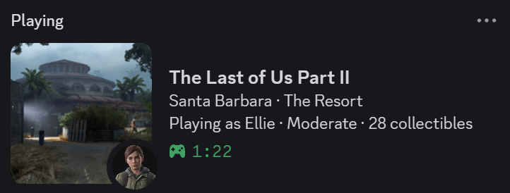
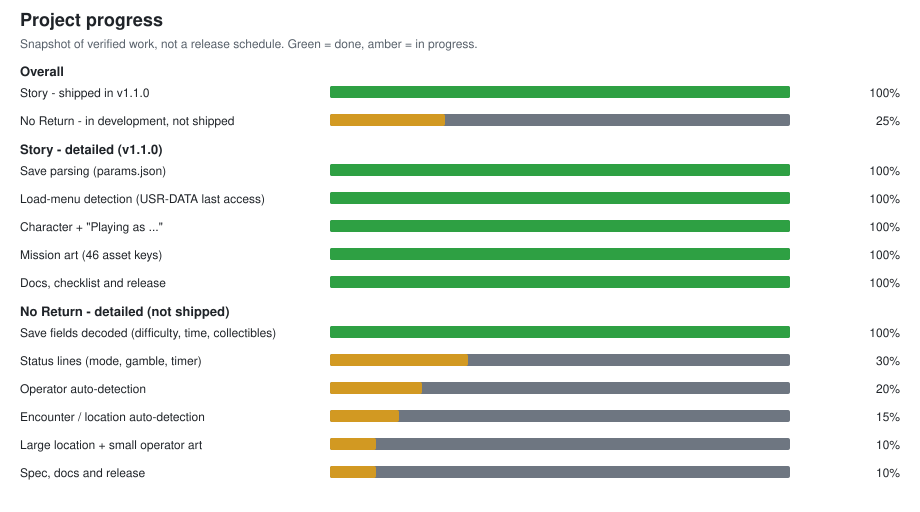

<h1 align="center">The Last Of Us Part II Discord RPC Mod</h1>


Shows what you're playing in The Last of Us Part II Remastered as a Discord status:



**[Download on Nexus Mods](https://www.nexusmods.com/thelastofuspart2/mods/965?tab=description)**

It reads the game's own autosave metadata (`params.json`), so there is **no
game modification**, no memory reading, and nothing to update when the game
patches. It runs hidden, polls every few seconds, clears your status the moment
the game closes, and exits on its own after a few minutes.

It can run two ways: as a standalone helper started by `start_tlou2_rpc.vbs`
(this folder), or as an ASI plugin that the game loads at launch - see
[Nexus package](#nexus-package-asi-plugin).

---

## Project status



The chart uses GitHub's dark-theme colours: a grey track, a green fill for
completed work and an amber fill for work still in progress. Its layout was
inspired by the [AnyPS5 progress page](https://boykopovar.github.io/AnyPS5/progress.html).
It is a snapshot of what is built and verified - not a release schedule. The
downloadable build is **v1.1.0** and contains story support only.

| Mode | Status | Done |
|------|--------|------|
| Story | Shipped in v1.1.0 | 100% |
| No Return | Research / design in progress, not shipped | ~25% |

### Story - detailed progress (v1.1.0)

| Area | Done | Notes |
|------|------|-------|
| `params.json` save parsing | 100% | Chapter, subchapter, difficulty, modifiers, collectibles, playtime. |
| Load-menu detection (`USR-DATA` last access) | 100% | Status updates within ~3 s of loading a slot. |
| Character and "Playing as ..." | 100% | Ellie / Abby / Joel, with chapter overrides. |
| Mission-specific large art | 100% | 46 keys; unknown keys fall back to `tlou2`. |
| Docs, checklist and release | 100% | README, changelog, `DISCORD-ASSETS.txt`, Nexus page. |

### No Return - detailed progress (not shipped)

| Area | Done | Notes |
|------|------|-------|
| Save fields (difficulty, playtime, collectibles, mode flag) | 100% | Decoded from `params.json`; not yet shown in a status. |
| Mode label / gamble difficulty / timer in the status line | 30% | Layout agreed; wiring waits on the spec. |
| Operator auto-detection | 20% | Model IDs and FNV-1a StringId scheme confirmed; live scan pending. |
| Encounter / location auto-detection | 15% | Areas and bosses catalogued; no live address confirmed yet. |
| Large (location) + small (operator) art | 10% | Keys and fallbacks planned; no assets uploaded. |
| Spec, docs and release | 10% | Held until the design is approved. |

See [No Return (in development)](#no-return-in-development) for the full
added / missing / needed breakdown.

---

## Quick start

1. Make sure Discord is running.
2. Start the game and the mod sees the save automatically.

Nothing visible happens - that is normal. A log is written to `rpc.log`.

To see what it detects without Discord: `py -3 tlou2_rpc.py --once`.
To watch it live: `py -3 tlou2_rpc.py --console`.

**Auto-start with Windows:** right-click `start_tlou2_rpc.vbs` → *Send to* →
*Desktop (create shortcut)*, then move that shortcut into
`%APPDATA%\Microsoft\Windows\Start Menu\Programs\Startup`.
The app sits idle until `tlou-ii.exe` appears, and it cannot run twice (a named
mutex blocks duplicates).

---

## One-time Discord setup (images)

The text works immediately. Images need assets uploaded to your Discord app:

1. Open <https://discord.com/developers/applications/"yourapp">.
2. **General Information** → set the app name to `The Last of Us Part II`
   (this is the bold first line of the status).
3. **Rich Presence → Art Assets** → upload PNGs with these **exact** keys:

   | Key     | Image                       | Used for                       |
   |---------|-----------------------------|--------------------------------|
   | `tlou2` | game art / box art          | large image                    |
   | `ellie` | Ellie portrait              | small image in Ellie chapters  |
   | `abby`  | Abby portrait               | small image in Abby chapters   |
   | `joel`  | Joel portrait               | small image in the prologue    |

   512×512 PNG is the safe size; square crops look best. Ready-made 512×512
   files are already in the `assets\` folder next to this README.
4. **Mission art (optional):** the large image changes with the mission.
   `DISCORD-ASSETS.txt` lists all 46 mission keys (`hillcrest`,
   `the_birthday_gift`, `the_confrontation`, `2425_constance`, ...) grouped by
   chapter. Upload a PNG under each key you want to use. The hover text is the
   mission name automatically.
5. Wait ~5-10 minutes for Discord to publish the assets.

Until a mission key exists, the helper retries with `tlou2`, so the box art and
character icons keep working while you add art. If even those are missing it
falls back to text only; the status text never breaks.

---

## Nexus package (ASI plugin)

`dist\TLOU2-Discord-Rich-Presence-<version>.zip` is the shippable mod:

```
avrt.dll                 44 KB proxy: forwards Windows AVRT, loads the .asi
TLOU2DiscordRPC.asi
TLOU2DiscordRPC\
  tlou2_rpc.py     (settings baked in - no config.json ships)
README.txt
```

Install is "extract into the game folder". No ASI loader is needed: the game
imports `AVRT.dll`, so Windows loads our small `avrt.dll`, which forwards every
call to the real System32 DLL and then loads `TLOU2DiscordRPC.asi`. The plugin
waits 2.5 s after launch and starts the helper with `CREATE_NO_WINDOW`. The
helper detects `tlou-ii.exe` itself, so nothing else needs configuring. If
another mod already owns `avrt.dll` in the game folder, don't overwrite it -
rebuild with a different proxy name instead.

No Python runtime ships. The mod requires Python 3 installed by the user
(python.org installer; standard library only, no pip). Shipping a full runtime
made the archive 7 MB, stuffed with `.exe`/`.dll`/`.pyd` files and a nested
`python313.zip`, which is exactly what gets a mod quarantined - and it pinned
the helper to one interpreter version. The launcher finds, in order, a
`pythonw.exe` beside the script, `pythonw.exe` on PATH, then `pyw.exe`, so a
default python.org install works without touching PATH.

`config.json` is read at build time and XOR/base64 encoded into the shipped
script, so the package exposes no application id, templates or asset keys, and
dropping a `config.json` next to it does nothing (a build with embedded settings
ignores it). That is obfuscation, not encryption - a determined person can still
decode the blob or read the app id out of memory, but there is no settings file
to edit and nothing to re-point.

Rebuild the package with:

```powershell
powershell -NoProfile -ExecutionPolicy Bypass -File .\pack.ps1 -Version 1.0.1 `
  -Gcc "C:\path\to\x86_64-w64-mingw32-gcc.exe"
```

The build is reproducible: the plugin is compiled from the project root with
relative paths and with `-Wl,--image-base=0x140000000`, because w64devkit's
linker randomises the PE image base (and therefore the checksum and every
absolute pointer in `.data`) on each run. With both pinned, the same sources
produce the same `.asi` and, when `config.json` is unchanged, the same zip.

Any Python 3 on PATH is used only for the build's smoke test. `dll\launcher.c`
is deliberately tiny and never hooks the game: it finds the app folder next to
the `.asi` and spawns the interpreter (beside the script, then `pythonw.exe` on
PATH, then the `pyw.exe` launcher). It writes `launcher.log` beside the script,
or to `%LOCALAPPDATA%\TLOU2DiscordRPC\` if the game folder is read-only. The
Nexus page text is `mod\NEXUS-PAGE.txt`; the zip README is `mod\README.txt`.

---

## Configuration (`config.json`, build time only)

In this folder `config.json` is the source of truth; `pack.ps1` embeds it into
the shipped `tlou2_rpc.py`. The released mod has no settings file, on purpose.

| Key | Meaning |
|-----|---------|
| `client_id` | Your Discord application ID. |
| `game_process` | Process to watch. Default `tlou-ii.exe`. |
| `save_dir` | Save folder. Empty = auto-detect in `Documents\The Last of Us Part II`. |
| `poll_seconds` | How often the save is checked. Default 3. |
| `idle_exit_seconds` | Exit if the game never starts within N seconds. `0` = wait forever. |
| `exit_when_game_closes` | Clear the presence as soon as the game closes. |
| `relaunch_grace_seconds` | Keep waiting this long for the game to come back (after a crash or quick restart) before exiting. `0` = exit immediately. |
| `detect_loaded_save` | Show the save you just loaded from the load menu, without waiting for the next autosave. Default `true`. |
| `presence.show_*` | Toggle chapter / character / difficulty / modifier / collectibles / timer. |
| `presence.details_template` | Line 1. Default `"{chapter}"`. |
| `presence.state_template` | Line 2. Default `"{character} · {difficulty} · {collectibles}"`. Empty parts disappear. |
| `presence.character_prefix` | Text before the character name. Default `"Playing as "`. Set `""` for just `Ellie`. |
| `presence.large_image` / `large_text` | Fallback large asset key and its hover text. |
| `presence.large_text_template` | Large-image hover text. Default `"{subchapter}"`; set `""` to use `large_text`. |
| `presence.small_image_from_character` | Use the character portrait as the small image. |
| `presence.character_assets` | Character name → asset key. |
| `character` | `auto`, or force `Ellie` / `Abby` / `Joel`. |
| `character_overrides` | Chapter or subchapter → character, for the few ambiguous ones. |

The status updates at every autosave (checkpoints, chapter starts). Playtime is
seeded from the save and keeps ticking in Discord between saves.

### Loading a save from the menu

Loading a manual save does not rewrite the current autosave - the game only
does that at the next checkpoint or on quit - so a status based on autosaves
alone would stay wrong until you restarted. To avoid that, the app also checks
the **last access time of each slot's `USR-DATA`**, which Windows updates when
the game actually reads that slot to load it. If a slot was read more recently
than the autosave was written, that slot is shown immediately (within one poll,
~3 s). The next autosave takes over again, since by then it holds the same
position. This needs Windows last-access tracking, which is on by default on
Windows 10/11 (`fsutil behavior query disablelastaccess` → `2`).

### Character detection

The save stores `Chapter - Subchapter`, e.g. `Seattle Day 2 - Hillcrest`.
Subchapters unique to Abby (`The Stadium`, `The Aquarium`, `The Island`,
`Ground Zero`, ...) map to Abby, `Jackson - Prologue` maps to Joel, everything
else defaults to Ellie. If a chapter ever guesses wrong, add it to
`character_overrides`, or lock the whole app with `"character": "Abby"`.

---

## No Return (in development)

No Return support is being designed, not shipped. Nothing in this section is
part of v1.1.0. The goal is the same automatic, hands-off status as story mode -
no manual operator or encounter picker, and no changes to save files.

### What's added / confirmed

- Identified the No Return save slot and its mode flag (`00 80` versus `00 00`
  in story saves), so the two modes can be told apart.
- Decoded difficulty, playtime and collectibles in `params.json` - fields the
  story status already knows how to render.
- Confirmed the game's in-game character model IDs (`ellie`, `abby`, `joel` and
  the other operators) and No Return level names, and that the game stores
  these names as 64-bit FNV-1a StringIds rather than plain text.
- Catalogued the reference data: 12 operators, 24 encounter areas, 6 boss
  encounters and 4 encounter types.
- Confirmed that no operator or encounter value is written to disk, so the live
  values must come from process memory - and that the helper launched by the
  game already inherits its elevation, so users will not see a UAC prompt.

### What's missing

- Automatic operator detection: only the board's current selection is known so
  far; the helper does not read it.
- Automatic encounter / location detection, including boss encounters.
- The No Return status lines themselves - mode label, operator, gamble
  difficulty, run timer and encounter. The decoded fields are not rendered yet.
- No Return artwork: a large image per encounter/location and a small operator
  portrait, with the same graceful fallback as story art.
- A written spec, tests, changelog entry and release. The version stays at
  1.1.0 until the design is approved.

### What's needed next

1. Run an elevated, read-only memory scan at the No Return board with one
   operator selected, switch operator, and diff the results to isolate the
   live slot.
2. Verify a stable anchor and the StringId resolver for this game build, and
   define fallbacks so a missed read never blanks the status.
3. Approve the status templates and asset-key naming, then upload the images.
4. Implement behind a guarded read path, document it, and only then bump the
   version and package a release.

---

## Troubleshooting

| Symptom | Fix |
|---------|-----|
| Nothing appears | Is Discord running? Check the tail of `rpc.log`. |
| "no usable save found" | Play until the first checkpoint; the file only exists after an autosave. |
| Nothing appears with the plugin | Check `launcher.log`; if it is missing, make sure `avrt.dll` and the `.asi` are both in the game folder. |
| Status lags behind | Expected - it updates at checkpoints, not per second. Loading a save updates it within ~3 s. |
| Mission art not showing | That mission key isn't uploaded yet - see `DISCORD-ASSETS.txt`. It falls back to `tlou2` until you upload it. |
| Two copies running | Not possible; the second instance exits silently. |
| Wrong character | Edit `character_overrides` or set `character`. |

`rpc.log` rotates at 512 KB (`rpc.log.1` keeps the previous chunk).

---

## Files

| File | Purpose |
|------|---------|
| `tlou2_rpc.py` | The app (pure Python standard library, no installs). |
| `config.json` | All settings. |
| `start_tlou2_rpc.vbs` | Silent launcher (hidden window). |
| `rpc.log` | Runtime log, created on first run. |
| `assets\*.png` | The four ready-made 512×512 Discord art assets. |
| `DISCORD-ASSETS.txt` | Checklist of all 46 mission asset keys + 4 base/character keys to upload. |
| `pngs\` | Source art for the character portraits. |
| `make_assets.ps1` | Rebuilds `assets\` from `pngs\` and `assets\raw\tlou2.png`. |
| `dll\launcher.c` | ASI plugin that starts the helper with the game. |
| `dll\avrt_proxy.c`, `dll\avrt_stubs.S`, `dll\avrt_proxy.def` | Source of the `avrt.dll` proxy that loads the plugin. |
| `dll\avrt.dll` | Built proxy (copy of the one in the game folder). |
| `dll\TLOU2DiscordRPC.asi` | Built plugin (copy of the one in the game folder). |
| `pack.ps1` | Builds the plugin and the Nexus zip. |
| `mod\` | Text used in the shipped package (README, Nexus page). |
| `dist\` | Build output: staging folder and the release zip. |
| `promo\promo.html` | Source of the mod-page promo image (1920×1080 HTML/CSS). |
| `promo\TLOU2-Discord-RPC-promo-1920x1080.png` | Promo image for the Nexus page / social post. |
| `promo\TLOU2-Discord-RPC-promo-1280x720.png` | Smaller copy for embeds and thumbnails. |
| `promo\nexus-header.html` | Source of the Nexus header banner (1300×372). |
| `promo\TLOU2-Discord-RPC-nexus-header-1300x372.png` | Nexus mod-page header image. |
| `promo\progress.svg` | The progress chart shown in "Project status". |
| `promo\make_progress.py` | Regenerates `promo\progress.svg` from the percentages in the status tables. |

## How it works

Windows named pipe `\\.\pipe\discord-ipc-0..9` → opcode 0 handshake with the
app ID, then opcode 1 `SET_ACTIVITY` frames with a nonce. Pipe reads are
non-blocking (`PeekNamedPipe` + `ReadFile` on available bytes), so the app
answers pings, notices a dead pipe, and reconnects without threads or hangs.
Missing assets fall back to a text-only status.
